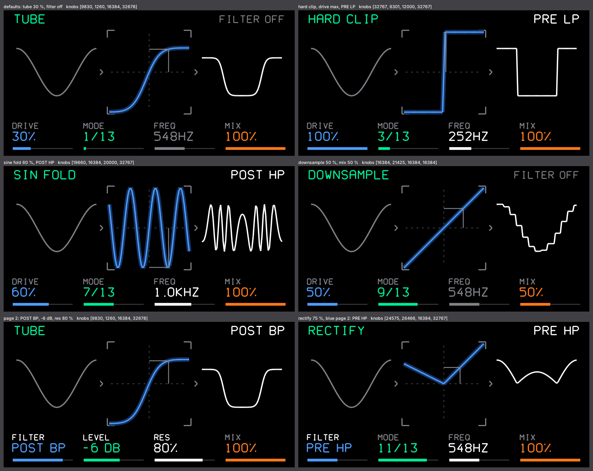

# drive — Serum-style distortion (FX)

A distortion modelled on the workflow of Serum's distortion module: 13 waveshaping modes, a drive gain, a
state-variable filter before or after the shaper, dry / wet mix and output level. The screen shows what Serum
shows (the transfer curve and the shaped wave) in the OP-1's own line style. The modes are our own formulas, named
after Serum's and tuned by ear to behave like them; they are not copies of Serum's curves.

Sound: [drive_audio.wav](drive_audio.wav) (`harness/audio.py drive`, defaults).

## Knobs

| knob | page 1 | page 2 (press) |
|---|---|---|
| blue | **drive**: 1x .. 40x (0 .. 32 dB); folds 1x .. 10x; downsample 1 .. 64 samples; rectify amount | **filter**: OFF, PRE LP / BP / HP, POST LP / BP / HP |
| green | **mode**: 13 shapers (below) | **level**: output −24 .. +6 dB |
| white | **cutoff**: 30 Hz .. 10 kHz (exponential) | **resonance** |
| red | **mix**: dry .. wet | – |

Modes: TUBE (biased tanh: even harmonics), SOFT CLIP (tanh), HARD CLIP, DIODE 1 (one half soft-clipped), DIODE 2
(softer asymmetric knee), LIN FOLD (triangle folder), SIN FOLD (sine folder), ZERO-SQUARE (sign(x)·x²: squeezes the
zero crossing), DOWNSAMPLE (sample hold), ASYM (offset hard clip), RECTIFY (clean → half-wave → full-wave),
X-SHAPER (x − 0.15 sin 2πx: a stepped curve), X-SHAPER ASYM (the same on the positive half).

Signal path: in → [filter PRE] → drive → shaper → [filter POST] → mix → level. A ~35 Hz DC blocker recentres the
asymmetric modes. On the master the FX runs on the mono sum, like the other plugins (the wet part is mixed back).

Screen: mode name (green) and filter state at the top; the transfer curve at the current drive and mix, with a dot
where the signal's peak sits on it; one period of a sine before and after the curve, scrolling slowly; the four
knobs of the current pages with their colour and a bar each (a knob on page 2 has a white label).

## DSP in short

- Fixed point (Q15), no float. Per sample: table lookups, multiplies and shifts only. tanh (a Padé fit, exactly
  1.0 from |x| = 3) and x / (1 + |x|) come from tables of |x| in steps of 1/64 with linear interpolation (≤ 3 LSB
  from the formulas). Drive, mix and level ramp linearly over each 64-sample block (no zipper noise); the ramps
  divide once per block.
- Filter: Chamberlin state-variable filter, 2x oversampled, state clamped (it cannot run away at full resonance).
- Words (saved with the sound): 0..3 page 1 (raw, `op1_fx_param_q15`), 4 the selector, 5 filter (7 zones),
  6 level, 7 resonance (0..32767). State per FX position (synth, drum, master); `init` only marks the state for a
  reset on the next block.
- `gen_drive_tables.py` writes `drive_tables.h` (gains, cutoff, level, downsample length, quarter sine, shapers).

## Verification

Host (`harness/drive_test.c`, UBSan and ASan on):
- shaper tables against the exact formulas over their whole range: ≤ 2 LSB (tanh), ≤ 3 LSB (x / (1 + |x|));
- every mode × 8 drive values × 7 filters × 3 resonances × 4 cutoffs × 4 signals (110 Hz and 9 kHz full-scale sines,
  noise, full-scale square), 400 blocks each (14 M blocks): no signed overflow, the filter never locks up;
- per-mode output level and DC for a −6 dB sine at drive 0 / 50 / 100 %;
- the 7 filter zones, the default words, positions independent, `init` resets, both pages draw.

`make_plugin.py drive` builds the plugin file (15 KB, imports `op1_fx_page` only). The audio path calls no library
division (checked in the listing).

Hardware: an earlier build of the same DSP (with divisions in the soft shapers and one page switch for all knobs)
was flashed on op1r 12 and sounded right. This plugin version has not been flashed yet; its CPU load on the
resource monitor is still to be measured.
